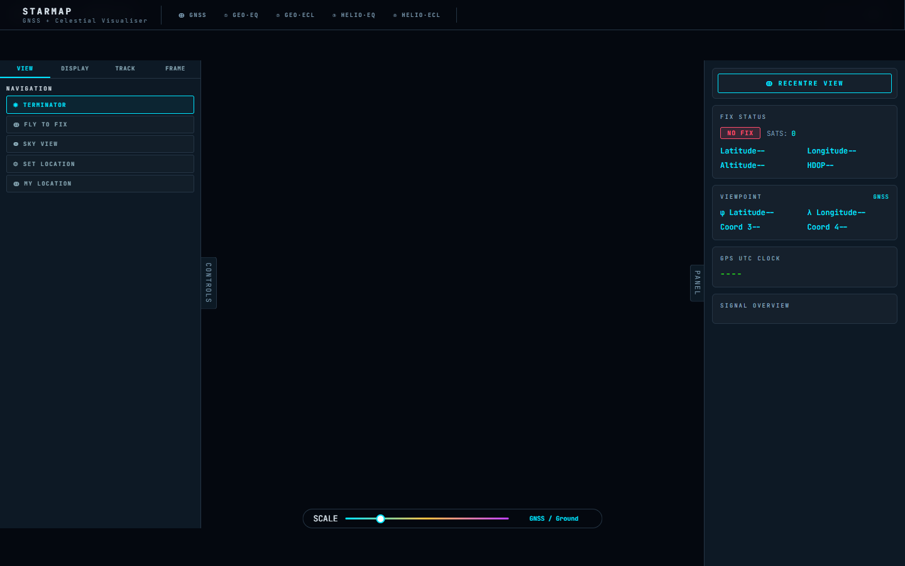

# STARMAP

[](https://github.com/clubTchief/starmap/actions/workflows/uptime-check.yml)
[](https://github.com/clubTchief/starmap/actions/workflows/deploy-cloud-run.yml)

STARMAP is an interactive geospatial and astrodynamics visualization app that combines live GNSS tracking, satellite tracking, and Solar System views.

## Features

- Live GNSS position and satellite signal tracking, with simulated GPS for development
- Earth-centered and heliocentric equatorial/ecliptic reference frames
- Satellite orbit tracking and ground tracks (ISS is tracked by default)
- Star catalogue and celestial reference-grid overlays
- Health and metrics endpoints for monitoring



## Run locally

### Requirements

- Java 25
- Maven
- Node.js 24 for browser smoke tests
- Internet access for CesiumJS map assets and satellite data

### Start with simulated GPS

Simulation is recommended unless a supported GPS receiver is connected. In PowerShell:

```powershell
$env:GPS_SIMULATE = "true"
$env:STARMAP_ALLOW_ANONYMOUS_WRITES = "true"
mvn spring-boot:run
```

In Bash:

```bash
GPS_SIMULATE=true STARMAP_ALLOW_ANONYMOUS_WRITES=true mvn spring-boot:run
```

This enables anonymous writes for local development only; public deployments deny writes unless Google sign-in or an API key is configured. Open <http://localhost:8080>. The health endpoint is <http://localhost:8080/actuator/health>.

To use a physical receiver, leave `GPS_SIMULATE` unset or set it to `false`; the serial defaults are COM8 at 9600 baud.

### Run with Docker Compose

```powershell
docker compose up --build
```

Compose enables GPS simulation and local anonymous writes, publishes port 8080, and persists the satellite cache in a named volume. Do not expose this development configuration as a public service.

### Run browser smoke tests

Start STARMAP with simulated GPS, then install the Node development dependency and run the Puppeteer checks:

```powershell
$env:GPS_SIMULATE = "true"
mvn spring-boot:run
```

In another terminal:

```bash
npm ci
npm run test:browser
```

The browser smoke tests verify that frame, star, and satellite controls and handlers are served, then load the satellite status and star catalogue through the browser. Set `STARMAP_BASE_URL` to test another running instance.

## Releases

Create a `v*` tag on `main` whose version matches the project version in `pom.xml` (for example, `v1.0.0`). The release workflow verifies the application and publishes the versioned JAR, a CycloneDX JSON SBOM, and a SHA-256 checksum manifest alongside the generated release notes.

## Configuration

Spring Boot properties can be overridden with environment variables:

| Environment variable | Purpose | Default |
| --- | --- | --- |
| `GPS_SIMULATE` | Use simulated GPS instead of a serial receiver | `false` |
| `GPS_SERIAL_PORT` | GPS receiver serial port | `COM8` |
| `GPS_SERIAL_BAUD` | GPS receiver baud rate | `9600` |
| `OBSERVER_DEFAULT_LAT`, `OBSERVER_DEFAULT_LON`, `OBSERVER_DEFAULT_ALT` | Initial observer location | Mumbai |
| `SAT_TRACK_NORAD_IDS` | Comma-separated satellite catalog IDs | `25544` (ISS) |
| `STARMAP_GOOGLE_CLIENT_ID` | Google OAuth web client ID for browser sign-in | unset |
| `STARMAP_ALLOWED_EMAILS` | Comma-separated exact Google account emails allowed to write | unset |
| `STARMAP_API_KEY` | Shared key for non-browser API clients | unset |
| `STARMAP_ALLOW_ANONYMOUS_WRITES` | Allow unauthenticated writes; use only for isolated local development | `false` |

Reads and the public frontend remain open. Observer and satellite write actions require an approved Google sign-in or the server-side API key; anonymous writes are denied by default. The browser keeps its Google ID token in memory and sends it only as a bearer token. It never receives or stores `STARMAP_API_KEY`. If a Google client ID is configured without an email allowlist, the application fails at startup.

To enable browser sign-in in production, create a Google OAuth web client and add the site's origins (`https://tiara.club`, `https://www.tiara.club`, and the Cloud Run URL) as authorized JavaScript origins. Set the client ID and comma-separated exact email allowlist on the Cloud Run service, for example:

```bash
gcloud run services update starmap --region europe-west1 \
  --update-env-vars="^:^STARMAP_GOOGLE_CLIENT_ID=your-client-id.apps.googleusercontent.com:STARMAP_ALLOWED_EMAILS=you@example.com,another@example.com"
```

Add `http://localhost:8080` as an authorized origin for local sign-in. To explicitly allow anonymous writes in an isolated local instance, set `STARMAP_ALLOW_ANONYMOUS_WRITES=true`. Keep `STARMAP_API_KEY` server-side and never commit it.

## Troubleshooting

- **No GPS fix:** Use simulated GPS for development, or check the serial port and baud rate for the connected receiver.
- **Globe or map imagery is blank:** Check that the browser can access the required CesiumJS assets and map services.
- **Satellite data is missing:** Confirm outbound internet access; satellite elements are fetched from CelesTrak and cached locally.
- **Application fails during startup:** Run `mvn -B verify` and check the application logs for Orekit data or port errors.

## Deployment

Production runs on [Google Cloud Run](https://tiara.club) in `europe-west1`. Changes to application, Docker, Orekit data, or deployment workflow files on `main` run Maven verification and deploy a new revision. Documentation-only changes do not trigger deployment; the workflow can also be started manually from GitHub Actions.

GitHub tracks these deployments under the `cloud-run-production` environment. The scheduled uptime workflow checks `/actuator/health` every 15 minutes.
